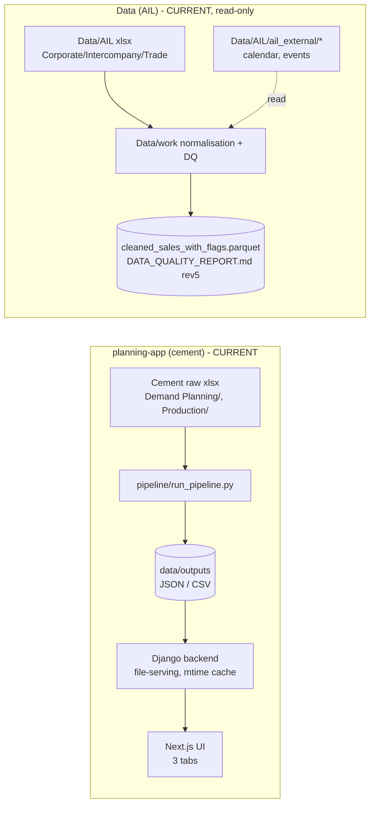

# STAGE 0 - System Analysis and Framework Design
### AIL demand forecasting (steel) - reusable, configuration-driven, 12-month horizon
Status: **CHECKPOINT 1 - awaiting approval. No code has been changed.**

---

## 0. Scope of this document
Deliverable for Stage 0. It (A) analyses the existing system, (B) designs the reusable forecasting
framework, and (C) gives the integration plan, output schemas and new-SBU onboarding procedure.
The existing assets found on this machine are used read-only.

---

## A. EXISTING SYSTEM ANALYSIS

### A.1 What exists on disk
```
Demand Forecast-Planning- Production Planning/
  planning-app/            <- the working UI + pipeline system (target for integration)
    backend/               Django (plain JsonResponse), no DB tables used
    frontend/              Next.js 16 (React 19, Recharts, Tailwind v4)
    pipeline/              Python: raw -> artifacts (cement demand/production)
    data/{raw,interim,outputs}
  Ui/                      <- a stripped copy of planning-app (dummy data; a UI shell)
  Data/
    AIL/                   <- the three Anwar Ispat monthly sources + external variables
      AIL Corporate Monthly Data-2023-2026.xlsx
      AIL-Intercompany_-2023_2026.xlsx
      AIL-Trade_monthly-2023 to 26.xlsx
      ail_external_metadata.csv, ail_external_monthly.csv
      ail_external/        <- events, holidays, eid closures, source points, build/fetch scripts
    work/                  <- the data-quality layer (SQL/parquet + report + code)
      code/common.py       <- normalisation layer (the seed for the source adapters)
      outputs/             <- DATA_QUALITY_REPORT.md (rev5), CHANGELOG.md,
                              cleaned_sales_with_flags.parquet, *.json, client_merge_review.csv
```
Notes / deviations from the brief (to confirm at the checkpoint):
- The brief lists `Data/external/` with `anwar_group_external_variables.csv`. **That folder is empty**
  and the **group external-variable catalog file does not exist** anywhere on disk. External files live
  in `Data/AIL/ail_external/`. The catalog must be derived from `ail_external_metadata.csv` (and the
  citations in `build_ail_external.py`) unless the real catalog is supplied.
- **There is no git repository** (`.git` absent at root, `planning-app/`, and `Ui/`). The rule "work on a
  branch" cannot be satisfied until `git init` is run; proposed at the checkpoint.

### A.2 Architecture
Two loosely-coupled worlds today:

1. **UI/pipeline world (`planning-app`)** - a *cement* demand/production dashboard.
   - Backend: Django, **file-serving only** (no models, no tables). Reads JSON/CSV from
     `data/outputs/` with an mtime cache. See `backend/api/views.py`, `backend/api/urls.py`.
   - Frontend: Next.js App Router; `/api` is proxied to Django (`frontend/next.config.ts`).
   - Pipeline: `pipeline/run_pipeline.py` orchestrates Python scripts; **no scheduler** (run manually).
2. **Data-quality world (`Data/work`)** - the AIL sales audit.
   - `code/*.py` (common.py normalisation + staged checks + report generators).
   - Outputs: `DATA_QUALITY_REPORT.md` (rev5), `cleaned_sales_with_flags.parquet`, `outputs/*.json`.

Languages: Python 3.12 (Django 5.2, pandas) + TypeScript/Next.js 16. Entry points: `manage.py runserver`,
`npm run dev|start`; pipeline `python pipeline/run_pipeline.py`; audit `python code/08|17_*.py`.

**No data pipeline already ingests AIL sales** (see A.4). Orchestration today is manual CLI. Tests today:
script-level asserts (`Data/work/code/08_consistency_tests.py`); no pytest/CI.

### A.3 Current data flow (Mermaid)


### A.4 Existing sales vs the data-quality layer
- The `planning-app` pipeline ingests **cement** item sales, not AIL steel. Therefore **no AIL monthly
  totals exist in the pipeline** to compare; the only AIL totals are in the DQ layer
  (`Data/work/outputs/monthly_totals_by_channel.csv`).
- The DQ layer already reconciles: row identity `CLB = OPB + Sales - Collection` = 100% where testable;
  period continuity 100%/93.4%/99.7% (CO/IC/TR). These become the **reference totals** the new pipeline
  must match exactly in Stage 1.4 (child series sum to parents; totals equal the DQ monthly totals).
- Consequence: Stage 0 A.4 finds **no conflict to resolve**, but the new Stage-1 validation is
  mandatory because the two worlds have never been wired together.

### A.5 UI data contract (what the UI reads)
| Route | Endpoint | Artifact the backend serves | Notes |
|---|---|---|---|
| `/demand-forecast-planning` | `/api/demand-planning/demand-forecast-v2`, `/api/demand-planning/bakeoff` | `data/outputs/demand_planning/demand_forecast_v2.json`, `bakeoff_leaderboard.json` | forecasts + model leaderboard |
| `/demand-planning` | `/api/demand-planning/market-target` | `.../market_target.json` | target levers |
| `/production` | `/api/production/units`, `/api/production/materials?unit=` | `data/outputs/data/production_material_forecast.csv` (+meta/history/by_type) | BOM explosion |

- **Filters**: the UI filters client-side (plant picker, material selector, district drill-ins). Backend
  endpoints are parameterless except `production/materials?unit=`.
- **Refresh**: file mtime cache in the backend -> re-running the pipeline updates the UI without a
  restart. **No database is involved.**
- **User input**: the UI has **no write path** (no POST endpoints; login/overlay removed in the
  standalone build). Planner adjustments therefore need either a new POST endpoint or the CSV/Excel
  upload template described in Stage 5.

### A.6 Environment
- Python 3.12.10; Node 24.19; git installed. **No GPU** (Intel Iris Xe); 10-core i5-1334U, ~16 GB RAM.
- Present packages: pandas **3.0.6**, numpy 2.5.3, statsmodels 0.15.0, scipy, pyarrow, openpyxl,
  matplotlib. **Absent**: scikit-learn, lightgbm, statsforecast, prophet, pmdarima, torch.
- **Internet: available** (PyPI reachable) -> model weights (TimesFM/Chronos/Moirai) and
  `fetch_rainfall.py` (Open-Meteo) can be run; no credentials needed for rainfall.
- Secrets: none required for the local pipeline.

### A.7 Risks
1. **pandas 3.0.6 is very new** -> many libraries (statsforecast/lightgbm/prophet/torch wheels) may not
   yet support it. Mitigation: pin a reproducible env (e.g., a dedicated venv with pandas 2.2.x) rather
   than the global interpreter.
2. **No git** -> cannot branch; risk of unrecoverable edits. Mitigation: `git init` + commit baseline,
   then `feature/demand-forecasting`.
3. **No GPU + heavy zero-shot models** -> TimesFM/Chronos/Moirai on CPU; risk of exceeding the 30-min
   budget. Mitigation: cache weights, cap context, time each model, allow graceful skip.
4. **Missing external catalog** -> segment mapping (STEEL) must be inferred from metadata; confirm.
5. **Two copies of the UI (`planning-app` vs `Ui`)** -> integration must target one. Proposed:
   `planning-app` (functional). 
6. **Adding a new page/endpoint** must not change the three existing cement tabs.
7. **2025 Trade regime + structural break (DQ-30/31)** could make naive features leak a reporting
   artefact; handled by the intervention + sensitivity rules.

---

## B. FRAMEWORK DESIGN (reusable, config-driven)

### B.1 SBU registry (config: `config/sbus.yaml`)
One entry per SBU/source:
`sbu_id, segment_code (STEEL), source_adapter, files, column_map{date,quantity,value,client,zone,channel,manager},`
`hierarchy_levels [Company,SBU,Channel,Zone], cleaning_rules, external_segment, top_accounts{enabled,N}, min_history_months`.
New SBU = new entry (+ adapter if the file layout is new). No model/UI edits.

### B.2 Source adapters (`forecasting/adapters/`)
Generalise `Data/work/code/common.py` (the normaliser) into an adapter interface:
`load(source_cfg) -> DataFrame[series_id, sbu, channel, zone, client, month, y=MT, flags]`.
Ship three adapters (Corporate/Intercompany/Trade) parameterised by the registry; each returns the
one standard long frame. DQ flags (duplicates, null/zero, provisional) are carried as columns.

### B.3 External-data registry (config: `config/external_variables.yaml`)
One entry per variable derived from `ail_external_metadata.csv`:
`feature_key, source_file/column, publication_lag_months, future_value_type`
(`known_in_advance | leading | forecast_needed | scenario_only | constraint_flag | check_only`),
`transform, segments, sbus, enabled`. Publications lags are set from coverage/notes:
- known-in-advance: all calendar columns, `rod_vat_*`, `adp_fy_*` (annual level).
- leading / lagged: `remittance_usd_mn`, `lc_open_*` (respect `lc_interpolated_flag`).
- scenario-only / constraint: `disruption_days_full/partial`, `flood_*`.
- check-only or excluded: `usd_bdt_avg`, `cpi_*` (Round 2 only).
`calendar_provisional_flag` (2027) and `lc_interpolated_flag` are carried as caveat flags.

### B.4 Automated data-quality gate (`forecasting/dq_gate.py`)
Per SBU per run: duplicates; grain uniqueness; null-vs-zero (DQ-07/30 rule: both = "no sale" for volume);
date gaps; Year/Month vs Date; negatives; value-without-quantity (DQ-14/28); hierarchy sum checks;
history length. External checks: missing months, values outside historical range, stale series,
lag/leakage. **Hard failures stop that SBU; warnings are logged and surfaced to the UI.** Mirrors the
issues and severities already formalised in `DATA_QUALITY_REPORT.md`.

### B.5 Model registry (`forecasting/models/`)
One interface: `fit(train, exog) / predict(horizon, future_exog) -> {point, q025,q10,q50,q90,q975}`.
Each model declares `supports_exog, supports_intermittent, min_history_months, needs_gpu, zero_shot, level`.
Models: baselines (naive, seasonal naive, MA3/6, drift); ETS/damped; STL+ETS (MSTL); Structural
`UnobservedComponents` (+ intervention); SARIMAX; Theta; pooled LightGBM; top-account (Croston/SBA, TSB,
hurdle); zero-shot (TimesFM, Chronos-Bolt/Chronos-2, Moirai or TiRex). All on/off in config.

### B.6 Selection engine (`forecasting/selection.py`)
Rolling-origin backtest; rank per series per horizon bucket by WAPE (bias tie-break); top-k ensemble
(default 3, simple mean unless inverse-error better); fallback to seasonal naive / zero-shot ensemble;
record `reason` + external variables used. Buckets 1-3 / 4-6 / 7-12, continuity enforced across buckets.

### B.7 Hierarchy and reconciliation
Built from the registry: Company = SBU-external total + Intercompany; SBU-external = Corporate + Trade;
Trade = Zones; Corporate = top-accounts + residual. Compare bottom-up vs MinT; choose by backtest WAPE;
reconcile all quantiles consistently (`forecasting/hierarchy.py`).

### B.8 Planner adjustment layer
Either a new POST endpoint on the Django backend or a CSV/Excel upload read by the pipeline
(Stage 5.4). Stores statistical and adjusted side by side; never overwrites the statistical forecast;
never feeds training. FVA computed once actuals arrive.

### B.9 Output layer
New artifacts written under `planning-app/data/outputs/forecast/` with an `sbu` column so the UI
auto-includes new SBUs via filters. Files: `forecasts.json`, `actuals.json`, `backtest_metrics.json`,
`model_selection.json`, `external_variable_tests.json`, `planner_adjustments.json`, `run_metadata.json`
(schemas in C.2). The existing backend gains thin read endpoints; the existing three tabs are untouched.

---

## C. INTEGRATION PLAN

### C.1 Proposed target integration (Mermaid)
```mermaid
flowchart LR
  R[Data/AIL xlsx<br/>Corporate/Intercompany/Trade] --> AD[Adapters<br/>registry-driven]
  X[Data/AIL/ail_external/*] --> XR[External registry + lag gate]
  AD --> DQ[DQ gate]
  DQ -->|pass| FE[Feature builder]
  XR --> FE
  FE --> BT[Backtest + selection]
  BT --> FC[12-month forecast + reconcile + scenarios]
  FC --> OUT[(planning-app/data/outputs/forecast/*.json)]
  OUT --> BE[Django: new /api/forecast/* endpoints]
  BE --> UI[Next.js: new "AIL Demand Forecast" page<br/>SBU/channel/zone filters, bands, scenarios,<br/>accuracy, selection reasons, DQ status, caveats]
  PLL[Planner adjustments<br/>POST or CSV] --> OUT
```
Existing cement tabs continue to read their current artifacts unchanged.

### C.2 Minimum output schemas (adapted to repo file-JSON convention)
- **forecasts**: `run_id, created_at, sbu, series_id, level, channel, zone, account, month, horizon, scenario, model, point_forecast_mt, q025, q10, q50, q90, q975, is_final_selection`
- **actuals**: `sbu, series_id, month, actual_mt, provisional_flag, constraint_flag`
- **backtest_metrics**: `run_id, sbu, series_id, model, feature_set, horizon, horizon_bucket, origin, abs_error, wape, mase, bias, n_origins`
- **model_selection**: `run_id, sbu, series_id, horizon_bucket, selected_models, ensemble_weights, external_variables_used, reason`
- **external_variable_tests**: `run_id, sbu, series_id, feature_key, model, horizon_bucket, wape_without, wape_with, relative_change, decision`
- **planner_adjustments**: `adjustment_id, sbu, series_id, month, statistical_forecast_mt, adjusted_forecast_mt, reason, entered_by, entered_at, run_id`
- **run_metadata**: `run_id, code_version, config_hash, data_snapshot, external_snapshot, model_versions, decision_log_version, dq_gate_summary, run_time_seconds, notes`

### C.3 Proposed module location and files
```
planning-app/forecasting/            <- NEW package (does not touch existing pipeline/)
  config/{sbus.yaml, external_variables.yaml, models.yaml, horizons.yaml, selection.yaml}
  adapters/{base.py, corporate.py, intercompany.py, trade.py}
  dq_gate.py  features.py  backtest.py  selection.py  hierarchy.py  scenarios.py
  models/{baselines,ets,stl,structural,sarimax,theta,lgbm,top_accounts,zeroshot}.py
  run_forecast.py                    <- single entry point (one run = full pipeline)
  tests/                             <- pytest: adapter contract, registry validation,
                                        hierarchy sums, leakage, end-to-end fixture
  docs/forecasting/{00_...,01_model_report.md,onboarding_new_sbu.md,decision_log.md}
planning-app/data/outputs/forecast/  <- NEW artifacts (UI reads these)
```
Changes to existing code (minimal): add ~6 read endpoints in `backend/api/urls.py` + `views.py`;
add one Next.js route (`frontend/src/app/ail-demand-forecast/page.tsx`) + a nav link. No changes to the
cement pipeline or the three existing tabs.

### C.4 Trigger
Extend `planning-app/pipeline/run_pipeline.py` with a `forecast` stage that calls
`python forecasting/run_forecast.py` (one command: ingest -> DQ -> features -> backtest -> selection ->
final -> reconcile -> scenarios -> write). Scheduler (cron/Task Scheduler) optional; not present today.

### C.5 UI additions
New page "AIL Demand Forecast": SBU/channel/zone/account filters (populated from data), actuals vs
12-month forecast with 80/95% bands, provisional/constrained/low-confidence markers, scenario selector,
monthly+quarterly tables and 12-month total, accuracy (WAPE/MASE/bias by bucket, holdout, FVA), model
selection + external variables used with reasons, run info + DQ gate status, caveats panel. Reuses
existing components (`PageHeader`, card grid, Recharts patterns, states).

### C.6 Onboarding a new SBU (reusable procedure)
1. Add an SBU entry to `config/sbus.yaml` (segment code -> pulls external variables automatically).
2. Add an adapter only if the file layout is new (else reuse an existing one).
3. Set interventions, top-accounts switch, min-history. 4. Run `run_forecast.py --sbu <id>`.
5. Review the DQ gate + selection output in `outputs/forecast/`. No model/selection/UI code changes.

---

## D. ASSUMPTIONS MADE (working)
- The existing system to integrate with is `planning-app` (not `Ui`).
- External files live at `Data/AIL/ail_external/`; the missing group catalog is approximated from
  `ail_external_metadata.csv`.
- "Sales MT" is the target proxy for demand; all outputs labelled "Demand forecast (based on sales)".
- Intercompany is internal demand, reported separately.
- File-based artifacts (no DB) continue; no production/shared DB is written.

---

## E. CHECKPOINT 1 - decisions needed before code
1. **Git**: OK to `git init` in `planning-app/` (and commit the current baseline), then work on
   `feature/demand-forecasting`? (No repo exists today.)
2. **Target system**: confirm `planning-app` is the integration target (leave `Ui` as-is / delete?).
3. **External catalog**: supply `anwar_group_external_variables.csv`, or approve deriving the registry
   from `ail_external_metadata.csv` (segment STEEL)? Confirm the exact path the brief intended.
4. **Environment**: approve creating a **dedicated venv pinned to pandas 2.2.x** (recommended, given
   pandas 3.0.6 compatibility risk) and installing statsforecast, lightgbm, scikit-learn, and the
   zero-shot models (TimesFM/Chronos/Moirai) with cached weights?
5. **UI**: approve adding **one new page + new read endpoints** (vs extending an existing tab)?
6. **Planner input**: new POST endpoint, or CSV/Excel upload template (UI has no write path today)?
7. **DB**: confirm file-based outputs only (no Postgres/SQL writes) for now.

Stopping here as instructed. On approval I will proceed to Stage 1 (data layer, decision log,
adapters, series, external features, leakage tests).
