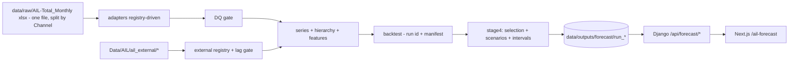

# AIL demand forecasting - project README

Reusable, configuration-driven monthly demand-forecasting pipeline for Anwar Ispat (AIL) steel, integrated
into `planning-app` so the UI displays forecasts, 12-month horizon. Target = **monthly invoiced sales volume
(MT) as a proxy for demand**; every output is labelled "Demand forecast (based on sales)". No data leaves the
machine.

## Architecture

The existing cement tabs are unchanged.

## Configuration
- `forecasting/config/config.yaml` - horizon, buckets, seeds, backtest/holdout dates, interventions, scenarios.
- `forecasting/config/sbus.yaml` - SBU registry (sources, column maps, hierarchy, top-accounts, min history).
- `forecasting/config/external_variables.yaml` - external registry with `catalog_var_id` linking to the group
  catalog; `not_available` entries for Phase-1 variables with no data.
- `forecasting/config/models.yaml` - model pool.

## How to run (one command, pinned venv)
```powershell
cd planning-app
.\.venv-forecast-pinned\Scripts\python.exe -m forecasting.run_forecast
# stages: ingest -> backtest(run id) -> stage4(explicit backtest run id) -> publish -> planner
```
The **canonical** environment is the pinned venv `.venv-forecast-pinned` (pandas 2.2.3, numpy 2.1.3,
statsmodels 0.14.4, scikit-learn 1.5.2, lightgbm 4.5.0, pyarrow 17.0.0, torch 2.13.0+cpu,
chronos-forecasting 2.3.2). The pinned run reproduces the earlier canonical run within 0.005%. (A faster
`.venv-forecast` that inherits system packages also exists, but it is not canonical.)
Every stage writes `run_<id>/manifest.json` with `status`; later stages consume an **explicit** run id and
reject any run whose status is not `ok`. Backtest timings are in `run_<id>/timings.json`.

## Results (current)

### Data checks (per SBU, every run)
One consolidated source (`data/raw/AIL-Total_Monthly-2023 to 2026.xlsx`, sheet `Data`) is read via the
generic `tabular` adapter and split into the three named sources by `filter: {column: Channel, value: ...}`.
Current ingest (`run_20261010T084919Z`): **11,069 rows**, **728 series** (account 719, channel 3,
company 1, sbu 1, zone 4). Channel totals MT: Corporate **193,008**, Trade **389,955**, Intercompany
**7,112**. Null and zero MT both mean "no sale" for volume. 2026-09 is provisional (flagged, still in
training). Hierarchy reconciles (child = sum of parents). DQ gate passes with warnings: Corporate 2
grain-duplicates, Intercompany 4 grain-duplicates, Intercompany 1 missing calendar month (2024-08, genuine).
(Intercompany 2023 was previously incomplete — 26 rows lost their dates in consolidation — and has been
backfilled from the original source for 2023-03..2023-12, so Intercompany now has 0 null dates.) The old
DQ cross-check `test_monthly_totals_match_dq_layer` is retired and now **skips** (the legacy DQ layer was
removed).

### Backtest leaderboard (mean overall WAPE, aggregate series; backtest run `20261010T084920Z`)
| model | WAPE |
|---|---|
| chronos_bolt | 0.2841 |
| naive | 0.3773 |
| ma3 | 0.3789 |
| ets | 0.3789 |
| ma6 | 0.4031 |
| structural | 0.4122 |
| lightgbm | 0.4394 |
| theta | 0.4544 |
| drift | 0.5019 |
| seasonal_naive | 0.5158 |
| sarimax | 0.5436 |
| stl_ets | 0.6489 |

`chronos_bolt` now runs in-pipeline at all 15 origins and leads the board. Fixes that produced this:
STL seasonal-index alignment; structural switched to a stable local-level seasonal state-space (no slope
extrapolation, no exog) with clipping; SARIMAX restricted to a small exog set with clipping; per-series
slump intervention dummies (zero in the forecast period). Recent-origin WAPE (origins 2025-07..2026-02) is
reported alongside in `stage4/run_*/recent_origin_wape.json` (report only).

### Selection
`stage4/run_*/model_selection.json`: top-3 per series x bucket by WAPE (bias tie-break), equal weights,
`external_variables_used` recorded per selected model. `chronos_bolt` is the selected best model for most
series x buckets. External-variable candidate models (e.g. `lightgbm+remittance_usd_mn_yoy`) are registered
as candidates; the external-variable tests keep 5 combinations (see below) but **none of those candidate
models entered the final ensemble**, so no external variable is used.

### Final 12-month forecast (2026-10..2027-09)
| series | 12m forecast MT | last 12m actual | growth |
|---|---|---|---|
| AIL\|company | 187,370.0 | 176,989 | +5.87% |
| AIL\|sbu\|external | 184,674.8 | 174,588 | +5.78% |
| AIL\|channel\|Corporate | 44,978.4 | 45,816 | -1.83% |
| AIL\|channel\|Trade | 139,696.4 | 128,772 | +8.48% |
| AIL\|channel\|Intercompany | 2,695.2 | 2,402 | +12.23% |
| AIL\|zone\|Trade\|Dhaka | 82,641.2 | 71,367 | +15.80% |
| AIL\|zone\|Trade\|North | 22,309.2 | 21,136 | +5.55% |
| AIL\|zone\|Trade\|North East | 12,987.6 | 12,431 | +4.48% |
| AIL\|zone\|Trade\|South | 21,758.4 | 23,838 | -8.73% |

Final reconciliation is bottom-up; children sum exactly to parents per month, scenario and quantile.

### Scenarios (SARIMAX-delta; same ensemble as base)
`delta = SARIMAX(scenario exog) - SARIMAX(base exog)` on the same data, added to the selected base forecast.
Scenario runs use the **same ensemble** as base. Coefficients for `disruption_days_full` / `flood_major_flag`
with 95% CI are in `stage4/run_*/scenarios.json`; where a coefficient is positive or its interval spans zero
the effect is reported as **not estimable from history** (13 series/feature pairs in this run). Example
(base vs disruption vs flood, 12m MT, `AIL|company`): **187,370.0 / 189,708.1 / 185,914.5**.

### Intervals and holdout
Conformal intervals from the selected best model's backtest residuals (per series x bucket; offset =
-quantile(pred-actual)). Holdout (origin 2026-03, targets 2026-04..09): per-series WAPE + 80%/95% coverage in
`stage4/run_*/holdout.json`; mean holdout WAPE **0.256**, mean 80% coverage **0.815** (above 0.65 -> no
widening required). The holdout is never used for selection/tuning/variables.

### Sensitivity
- Provisional anchor: excluding 2026-09 from training changes each series' 12m total by <-3% (see
  `stage4/run_*/provisional_sensitivity.json`); flagged per series when >3%.
- Level-tracking weight: fraction of the selected ensemble on naive/MA3/MA6 is recorded per series
  (`provisional_sensitivity.json:level_tracking_weight`).
- DQ-30: 2025 down-weighted and 2025 imputed variants (see `stage4/run_*/sensitivity_selected.json`;
  Intercompany moves -19.79% / -25.39% respectively, all other series ~0-3%).

### Top accounts
Bottom-up Corporate (top-20 re-selected per origin by trailing 24m) WAPE(1-6) **0.2296** vs direct Corporate
**0.3193** -> bottom-up selected. `stage4/run_*/top_accounts.json`; UI has a collapsible "Corporate top
accounts" table.

### Clipping audit
`stage4/run_*/clipping.json`: backtest events (sarimax, structural) and stage4 events, with raw/clipped values.
Current run: 53 backtest events, 2 stage4 events.

### Catalog linkage
`forecasting/validate_registry.py` validates `external_variables.yaml` against the group catalog by
`catalog_var_id` -> **PASS** (43 variables, 0 mismatches).

### Zero-shot
torch (CPU wheel) and Chronos-Bolt are installed and run in a clean process; `chronos_bolt` now runs
**in-pipeline** at all 15 backtest origins (torch is imported before pandas in a subprocess to avoid the
Windows torch DLL conflict) and leads the leaderboard at WAPE 0.2841. See `01_model_report.md`.

### Known limitations
Demand proxied by sales; 2024-25 structural break; 2025 Trade reporting regime (DQ-30); provisional 2026-09;
provisional 2027 holidays; interpolated LC months; thin evidence for months 7-12; planner adjustments not yet
ingested (FVA implemented, tested synthetically).

## Revision history (superseded)
- Earlier reports quoted naive/ETS ~0.377 and structural 0.992 / sarimax 0.745 (implementation bugs since
  fixed); Trade 2025 "59.3% collection base" (artefact of the 2025 zero regime); cross-channel overlaps of 6
  (canonicalisation artefacts); scenarios as placeholder multipliers; conformal method string placeholder;
  zero-shot "skipped in-pipeline" (now runs in-pipeline and leads).
- Latest canonical run `run_20261010T084919Z` / backtest `run_20261010T084920Z` / stage4
  `run_20261010T090706Z`: consolidated single source, chronos_bolt in-pipeline, 53/2 clipping events,
  holdout WAPE 0.256 / cov80 0.815, company 12m 187,370.0 (+5.87%).
- `docs/forecasting/00_system_analysis_and_design.md`, `decision_log.md`, `onboarding_new_sbu.md`,
  `state_of_project.md`, `01_model_report.md` hold the detailed history.
