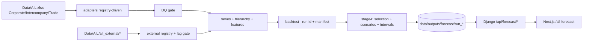

# AIL demand forecasting - project README

Reusable, configuration-driven monthly demand-forecasting pipeline for Anwar Ispat (AIL) steel, integrated
into `planning-app` so the UI displays forecasts, 12-month horizon. Target = **monthly invoiced sales volume
(MT) as a proxy for demand**; every output is labelled "Demand forecast (based on sales)". No data leaves the
machine.

## Architecture

The existing cement tabs are unchanged.

## Configuration
- `forecasting/config/config.yaml` - horizon, buckets, seeds, backtest/holdout dates, interventions, scenarios.
- `forecasting/config/sbus.yaml` - SBU registry (sources, column maps, hierarchy, top-accounts, min history).
- `forecasting/config/external_variables.yaml` - external registry with `catalog_var_id` linking to the group
  catalog; `not_available` entries for Phase-1 variables with no data.
- `forecasting/config/models.yaml` - model pool.

## How to run (one command, pinned venv)
```powershell
cd planning-app
.\.venv-forecast\Scripts\python.exe -m forecasting.run_forecast
# stages: ingest -> backtest(run id) -> stage4(explicit backtest run id) -> publish -> planner
```
Every stage writes `run_<id>/manifest.json` with `status`; later stages consume an **explicit** run id and
reject any run whose status is not `ok`. Backtest timings are in `run_<id>/timings.json`.

## Results (current)

### Data checks (per SBU, every run)
Sources are read from raw xlsx via adapters; exact duplicates + junk rows removed (Corporate 37,770 -> 37,766;
Intercompany 1,041 -> 1,006; Trade 31,038 -> 31,036). Null and zero MT both mean "no sale" for volume.
2026-09 is provisional (flagged, still in training). Hierarchy reconciles (child = sum of parents). Channel
monthly totals match the DQ layer to <= 0.005 MT. DQ gate passes with warnings.

### Backtest leaderboard (mean overall WAPE, aggregate series; backtest run `20261007T125419Z`)
| model | WAPE |
|---|---|
| naive | 0.377 |
| ets | 0.378 |
| ma3 | 0.379 |
| ma6 | 0.403 |
| structural | 0.412 |
| lightgbm | 0.440 |
| theta | 0.454 |
| drift | 0.502 |
| seasonal_naive | 0.516 |
| sarimax | 0.528 |
| stl_ets | 0.649 |

Fixes that produced this: STL seasonal-index alignment; structural switched to a stable local-level seasonal
state-space (no slope extrapolation, no exog) with clipping; SARIMAX restricted to a small exog set with
clipping; per-series slump intervention dummies (zero in the forecast period). Recent-origin WAPE
(origins 2025-07..2026-02) is reported alongside in `stage4/run_*/recent_origin_wape.json` (report only).

### Selection
`stage4/run_*/model_selection.json`: top-3 per series x bucket by WAPE (bias tie-break), equal weights,
`external_variables_used` recorded per selected model. External-variable candidate models (e.g.
`lightgbm+remittance_usd_mn_yoy`) are registered as candidates; under the strict test none was selected for
this run, so no external variable enters the ensemble.

### Final 12-month forecast (2026-10..2027-09)
| series | 12m forecast MT | last 12m actual | growth |
|---|---|---|---|
| AIL\|company | 185,723 | 176,989 | +4.93% |
| AIL\|sbu\|external | 183,173 | 174,588 | +4.92% |
| AIL\|channel\|Corporate | 44,978 | 45,816 | -1.83% |
| AIL\|channel\|Trade | 138,195 | 128,772 | +7.32% |
| AIL\|channel\|Intercompany | 2,550 | 2,401 | +6.20% |
| AIL\|zone\|Trade\|Dhaka | 80,044 | 71,367 | +12.16% |
| AIL\|zone\|Trade\|North | 22,021 | 21,136 | +4.19% |
| AIL\|zone\|Trade\|North East | 13,837 | 12,431 | +11.31% |
| AIL\|zone\|Trade\|South | 22,293 | 23,838 | -6.48% |

Final reconciliation is bottom-up; children sum exactly to parents per month, scenario and quantile.

### Scenarios (SARIMAX-delta; same ensemble as base)
`delta = SARIMAX(scenario exog) - SARIMAX(base exog)` on the same data, added to the selected base forecast.
Scenario runs use the **same ensemble** as base. Coefficients for `disruption_days_full` / `flood_major_flag`
with 95% CI are in `stage4/run_*/scenarios.json`; where a coefficient is positive or its interval spans zero
the effect is reported as **not estimable from history** (13 series/feature pairs in this run). Example
(base vs disruption vs flood, 12m MT): company 185,723 -> see `state_check/PC2_scenarios.csv`.

### Intervals and holdout
Conformal intervals from the selected best model's backtest residuals (per series x bucket; offset =
-quantile(pred-actual)). Holdout (origin 2026-03, targets 2026-04..09): per-series WAPE + 80%/95% coverage in
`stage4/run_*/holdout.json`; mean holdout WAPE **0.263**, mean 80% coverage **0.704** (above 0.65 -> no
widening required). The holdout is never used for selection/tuning/variables.

### Sensitivity
- Provisional anchor: excluding 2026-09 from training changes each series' 12m total by <-3% (see
  `stage4/run_*/provisional_sensitivity.json`); flagged per series when >3%.
- Level-tracking weight: fraction of the selected ensemble on naive/MA3/MA6 is recorded per series
  (`provisional_sensitivity.json:level_tracking_weight`).
- DQ-30: 2025 down-weighted and 2025 imputed variants (see `report_extra.json` item3).

### Top accounts
Bottom-up Corporate (top-20 re-selected per origin by trailing 24m) WAPE(1-6) **0.230** vs direct Corporate
**0.306** -> bottom-up selected. `stage4/run_*/top_accounts.json`; UI has a collapsible "Corporate top
accounts" table.

### Clipping audit
`stage4/run_*/clipping.json`: backtest events (sarimax, structural) and stage4 events, with raw/clipped values.
Current run: 54 backtest events, 3 stage4 events.

### Catalog linkage
`forecasting/validate_registry.py` validates `external_variables.yaml` against the group catalog by
`catalog_var_id` -> **PASS** (43 variables, 0 mismatches). Table: `state_check/PC2_catalog.csv`.

### Zero-shot
torch (CPU wheel) and Chronos-Bolt are installed and run in a clean process; in-pipeline they are skipped
(torch DLL conflict on Windows). See `01_model_report.md`.

### Known limitations
Demand proxied by sales; 2024-25 structural break; 2025 Trade reporting regime (DQ-30); provisional 2026-09;
provisional 2027 holidays; interpolated LC months; thin evidence for months 7-12; zero-shot not run
in-pipeline; planner adjustments not yet ingested (FVA implemented, tested synthetically).

## Revision history (superseded)
- Earlier reports quoted naive/ETS ~0.377 and structural 0.992 / sarimax 0.745 (implementation bugs since
  fixed); Trade 2025 "59.3% collection base" (artefact of the 2025 zero regime); cross-channel overlaps of 6
  (canonicalisation artefacts); scenarios as placeholder multipliers; conformal method string placeholder.
- `docs/forecasting/00_system_analysis_and_design.md`, `decision_log.md`, `onboarding_new_sbu.md`,
  `state_of_project.md`, `01_model_report.md` hold the detailed history.
