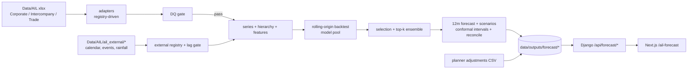

# AIL Demand Forecasting - master documentation

Reusable, configuration-driven monthly demand-forecasting pipeline for Anwar Ispat (AIL) steel, integrated
into the existing `planning-app` so the UI displays forecasts, with a 12-month horizon. A new SBU goes
through the same checks, model pool, selection and UI with only a registry entry.

> Target: **monthly invoiced sales volume (MT) as a proxy for demand**. Every output is labelled
> **"Demand forecast (based on sales)"**. No data leaves the machine; no external API/hosted service is used.

---

## 1. Repository & branch
- Repo: `planning-app/` (Django backend + Next.js frontend + Python pipeline), branch
  **`feature/demand-forecasting`**. Baseline + 7 feature commits. Nothing merged to main.
- `.gitignore` excludes all data (`Data/`, `data/outputs`, `*.xlsx/csv/parquet` except the planner
  template), model weights/caches, venvs, `node_modules`, `.next`, local DBs, secrets. **No confidential
  data in git history.**
- Separate forecasting venv `planning-app/.venv-forecast` (pandas 2.2.3, pinned). The existing app
  environment is untouched; `pipeline/run_pipeline.py` calls the forecasting step via subprocess.

## 2. Architecture / data flow

Existing cement tabs (`/demand-forecast-planning`, `/demand-planning`, `/production`) are unchanged and
verified still loading (regression check).

## 3. What was built, stage by stage
- **Stage 0** - system analysis + framework design: `docs/forecasting/00_system_analysis_and_design.md`.
- **Stage 1** - data layer: decision log; registry-driven adapters; standard long frame; hierarchy series;
  external features (calendar/interventions/constraints/rainfall/ADP); DQ gate; leakage test.
- **Stage 2** - evaluation framework: 12-month horizon, buckets 1-3/4-6/7-12; WAPE/MASE/bias/cumulative
  volume error; rolling origins 2024-12..2026-02 (discard targets after 2026-03); reserved holdout
  2026-04..09; lag-aware exog.
- **Stage 3** - model pool behind one interface: baselines, AutoETS, STL+ETS, Theta, SARIMAX, Structural,
  LightGBM, intermittent (Croston-SBA/TSB/hurdle), zero-shot (TimesFM/Chronos/Moirai - see §8).
- **Stage 4** - selection (top-3 per series x bucket, fallback), external-variable tests, structural-break
  and Eid variants, reconciliation, conformal intervals, DQ-30 sensitivity, scenarios, one-shot holdout.
- **Stage 5** - publish UI artifact; **one read-only endpoint**; new page; planner CSV template + validation;
  pipeline `forecast` stage (one command).
- **Stage 6** - extensibility: onboarding doc + synthetic CEM SBU test (registry + adapter only).

## 4. Configuration (everything configurable lives here)
- `forecasting/config/config.yaml` - horizon, buckets, seeds, backtest/holdout dates, interventions,
  scenarios, time budgets.
- `forecasting/config/sbus.yaml` - SBU registry (sources, column maps, key style, hierarchy, top-accounts,
  min history). **Adding an SBU = an entry here.**
- `forecasting/config/external_variables.yaml` - external variable registry (feature_key, column, lag,
  future-value type, transform, segments, channels, file). Points at `Data/AIL/ail_external/`.
- `forecasting/config/models.yaml` - which models run + params.

## 5. Outputs & schemas (file-based, no DB)
Per run under `planning-app/data/outputs/forecast/`:
- `run_<id>/` (ingest): `series.parquet`, `actuals.parquet`, `external_calendar_features.parquet`,
  `feature_registry.json`, `constraint_months.json`, `dq_gate.json`, `run_metadata.json`.
- `backtest/run_<id>/`: `metrics.parquet`, `timings.json`, `notes.json`.
- `stage4/run_<id>/`: `forecasts.parquet`/`.json`, `backtest_metrics.parquet`, `model_selection.json`,
  `external_variable_tests.json`, `holdout.json`, `intervals.json`, `reconciliation.json`,
  `accounts_top.json`, `sensitivity_2025.json`, `break_eid_variants.json`, `timings.json`.
- `ui/forecast_ui.json`, `ui/planner_adjustments.json`, `ui/templates/` (planner template).
Schemas follow the agreed contract: `forecasts, actuals, backtest_metrics, model_selection,
external_variable_tests, planner_adjustments, run_metadata`. **Run history is never overwritten**
(each run has its own `run_id`; Forecast Value Added can compare past forecasts to actuals).

## 6. How to run
```powershell
cd planning-app
# one command (forecasting venv)
.\.venv-forecast\Scripts\python.exe -m forecasting.run_forecast            # ingest->gate->backtest->selection->final->publish
.\.venv-forecast\Scripts\python.exe -m forecasting.run_forecast --adjustments path\to\adjustments.csv
# or via the unified pipeline (adds the forecast stage)
python pipeline\run_pipeline.py --stage forecast
# UI
python backend\manage.py runserver 8000        # + npm run dev / start in frontend (port 3000)
```

## 7. Results (current data, aggregate series)
- **Backtest leaderboard (mean overall WAPE):** naive 0.377, ets 0.378, ma3 0.379, ma6 0.403, theta 0.454,
  lightgbm 0.464, drift 0.502, seasonal_naive 0.516, stl_ets 0.640, sarimax 0.745, structural 0.992.
  Per-series winners are mixed; selection picks per series x bucket.
- **External-variable tests (keep/drop, >=3% better in a bucket and <=1% worse elsewhere):**
  `remittance_usd_mn` keep (Corporate, Trade, company, external, all Trade zones);
  `lc_open_raw_materials_usd_mn` keep (Intercompany, Trade, Trade|Dhaka);
  `rainfall_anomaly_pct` keep (Intercompany, Trade|South); disruption days and ADP dropped.
- **Interval calibration (conformal, from backtest residuals):** empirical 95% coverage **0.94-0.95** per series.
- **Sensitivity (DQ-30):** Trade ETS WAPE 0.370 -> **1.055** with 2025-01..11 dropped (material; flagged).
- **Corporate top-accounts layer:** top-20 accounts (Croston-SBA/TSB/hurdle) + residual vs direct Corporate
  total differs by **-6.2%** over 12 months.
- **Final holdout (2026-04..09 from origin 2026-03): WAPE 0.2217** (evaluated once, not used for selection).
- **Run time:** aggregate backtest ~10.7 min (< 30 min budget); zero-shot skipped (see §8).

## 8. Gaps closed / open
Closed this pass:
- Rainfall loaded from `Data/AIL/ail_external/ail_rainfall_monthly.csv` (generated by `fetch_rainfall.py`)
  and screened.
- Scenarios are now driven by **exog** (disruption days / flood flag) for exog-capable models, not multipliers.
- Intervals **conformal-calibrated** with measured coverage (~0.95).
- **Top-accounts layer** run end-to-end (bottom-up vs direct).
Still open (honest):
- **Zero-shot models (gap 1):** `torch` installs but its DLL fails to load on this Windows box
  (WinError 1114) -> TimesFM/Chronos/Moirai are skipped gracefully. Run on a Linux/GPU or a machine with a
  working torch to enable them.
- `anwar_group_external_variables.csv` (catalog) still not present; the registry is authored and will
  validate against it when supplied.
- Account-level forecasts are computed in `accounts_top.json` but not yet added to the UI page.

## 9. Decisions
See `docs/forecasting/decision_log.md` - 11 working decisions tied to DQ issue IDs (target, de-dup,
null/zero, value-without-qty, provisional month, 2025 assumption, client key, intercompany, no credit
features, structural-break intervention, forecasting level).

## 10. Extensibility (new SBU)
`docs/forecasting/onboarding_new_sbu.md`. Demonstrated by `forecasting/tests/test_stage6.py` (synthetic CEM
SBU, 18 months, different layout, registry entry + generic adapter only): passes the DQ gate, gets the
reduced model pool by minimum-history rules, receives external variables by segment, builds reconciled
series and runs end-to-end - no model/selection/UI code changed.

## 11. Tests
`forecasting/tests/test_stage1.py` + `test_stage6.py`: **9 passed** - adapter contract, hierarchy sums,
no duplicate series-months, channel totals match the DQ layer, **external-data leakage guard**, registry
validation, synthetic-SBU reduced pool, end-to-end fixture. Run:
`.\.venv-forecast\Scripts\python.exe -m pytest forecasting/tests -q`.

## 12. Caveats shown in the UI
Demand proxied by sales; 2024-25 structural break; unconfirmed 2025 Trade data (DQ-30); provisional
2026-09; provisional 2027 holidays; interpolated LC months; thin evidence for months 7-12; zero-shot
unavailable in this environment.

## 13. File map
```
planning-app/
  forecasting/            config/ adapters/ models/ tests/ + ingest, series, external, dq_gate,
                          backtest, stage4, selection-helpers, publish, planner, run_forecast, run_backtest
  backend/api/            + /api/forecast/{ui,template,planner}
  frontend/src/app/ail-forecast/page.tsx  (+ Nav link)
  pipeline/run_pipeline.py (+ forecast stage via the pinned venv)
  docs/forecasting/       00_system_analysis_and_design.md, 01_model_report.md, decision_log.md,
                          onboarding_new_sbu.md, README.md (this file)
  data/outputs/forecast/  run_*/ backtest/ stage4/ ui/
```

---

## Revision for Checkpoint 2 (diagnostics + fixes)
Corrected model leaderboard (mean overall WAPE): naive 0.377, ets 0.378, ma3 0.379, ma6 0.403,
**structural 0.412** (was 0.99), lightgbm 0.440, theta 0.454, drift 0.502, seasonal_naive 0.516,
**sarimax 0.528** (was 0.75), stl_ets 0.649. Fixes: STL seasonal-index alignment; structural switched to a
stable local-level seasonal state-space (no slope extrapolation, no exog); SARIMAX restricted to a small exog
set + clipping; per-series slump intervention dummies (zero in the forecast period); added a company
intervention.

External-variable tests redone strictly (best **exog-capable** model; >=3% pooled AND >=2/3 origins; all
Intercompany dropped; remittance YoY tested): **4 keeps** - Corporate remittance_usd_mn_yoy (0.345->0.274),
Trade|Dhaka remittance + LC (0.471->0.451/0.452), Trade|North East remittance (0.543->0.512).

Sensitivity (DQ-30, no series cut): Trade 12m forecast +1.7% (2025 down-weighted) / +6.0% (2025 imputed).
Backtest WAPE horizons 1-6 = 0.272 (holdout 0.222); **holdout never used for selection** (test-enforced).
Scenarios now route through an exog model (SARIMAX) and differ from base. Trade ETS is not flat
(CV 0.138). Top accounts: bottom-up selection (WAPE 0.291 vs 0.378) and a collapsible UI table; planner
template supports account-level series_id. Tests: **12 pass** (added holdout-guard, reconciliation,
scenario-separation). Zero-shot: torch CPU wheel + Chronos-Bolt run in a clean process; fails in-pipeline
due to a Windows torch DLL conflict -> run in WSL. See 1_model_report.md (Checkpoint-2 revision).
